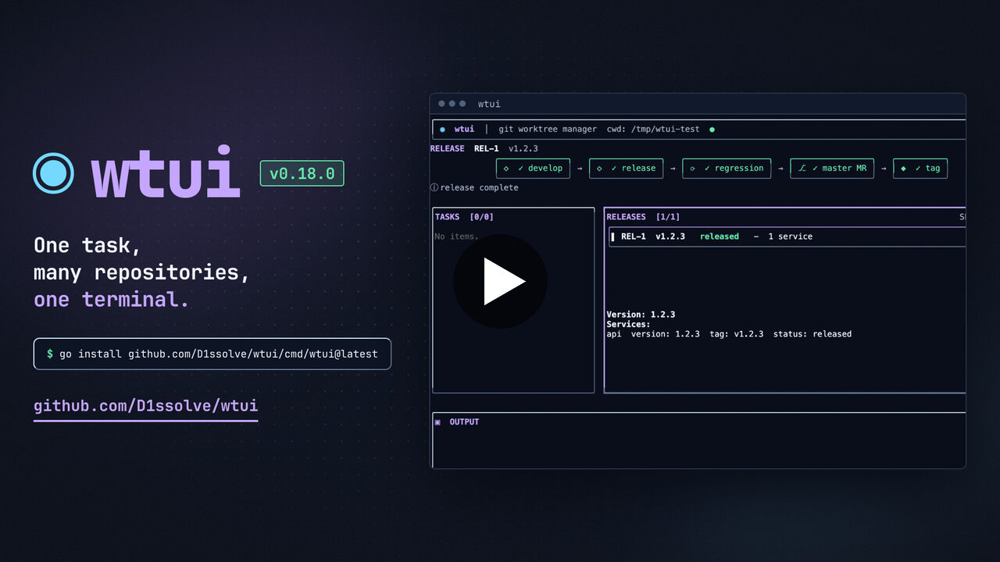
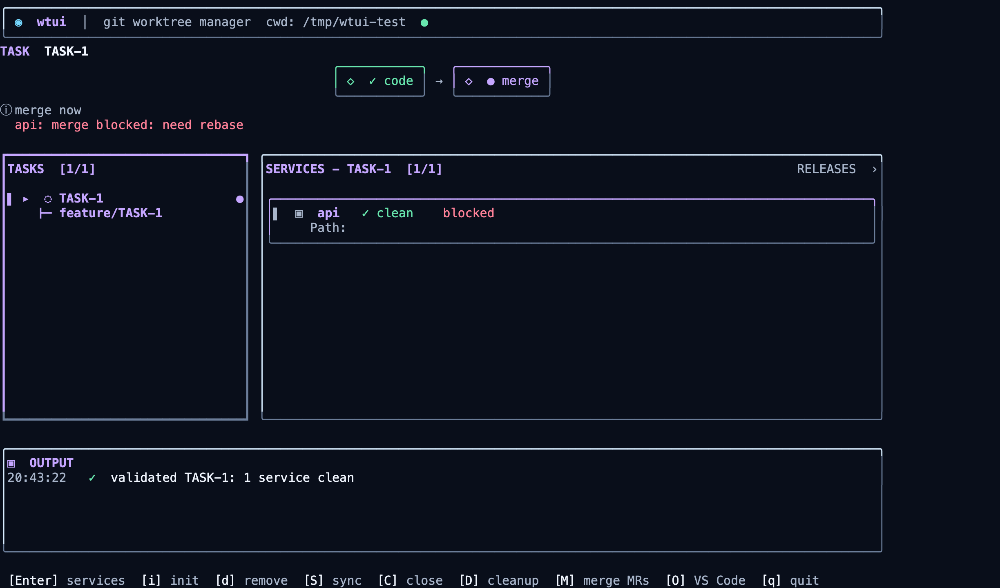
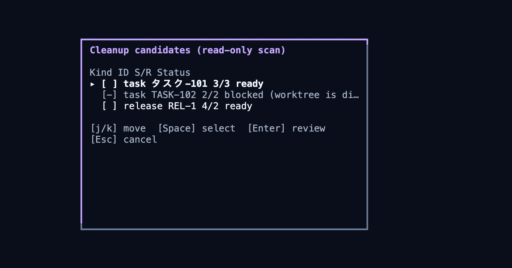

# wtui

[](https://github.com/D1ssolve/wtui/releases/latest)
[](go.mod)
[](LICENSE)

**One task, many repositories, one terminal.**

`wtui` is a terminal UI for managing task-scoped Git worktrees across multi-repository and microservice codebases.

[](https://github.com/D1ssolve/wtui/releases/download/v0.18.0/wtui-v0.18.0-launch.mp4)

## Why wtui

A feature rarely stays inside one repository. You create the same branch several times, arrange worktrees by hand, repeat sync and push commands, open PRs/MRs, then remember which services are ready to merge and release.

`wtui` treats that work as one task. Pick the repositories once, then manage their worktrees, branches, validation, reviews and releases from one screen.

**A good fit if you:**
- Work on features that span several Git repositories or microservices.
- Want isolated working directories without repeatedly switching branches.
- Use GitHub or GitLab and need to track PR/MR readiness across services.
- Coordinate task branches and per-service release versions.

Tools such as `lazygit` are excellent inside one repository. wtui focuses on the *cross-repository task and release lifecycle*, and opens lazygit for individual services.



## Highlights

New in 0.18: see the [release notes](https://github.com/D1ssolve/wtui/releases/tag/v0.18.0).

- **Task-scoped worktrees** - matching branches and worktrees across the repositories you select; sync, push, validate and inspect them together.
- **Your workflow, as configuration** - start from `git-flow`, `github-flow` or `trunk-based`, or describe your own task types and release state machines in YAML: gates, QA loops, CI waits, hooks, service order, per-service close targets.
- **See what wtui will do** - `wtui flow` prints the compiled workflow; `W` in the TUI, `wtui flow --mermaid` and `wtui flow --html` (works offline) draw it.
- **GitHub and GitLab** - create and inspect MRs/PRs through `gh` or `glab`; merging stays on the forge and wtui reconciles the result. GitHub merge queues and GitLab merge trains, fork + upstream via `forge.remote`.
- **Issues** - link a Jira, GitHub or GitLab issue to a task (Jira keys need `issues.jira_url`), or start a task from a GitHub/GitLab issue.
- **Releases** - per-service versions (optionally from Conventional Commits), promotion to production, tags, and GitHub/GitLab Release objects with the changelog.
- **Team defaults for MRs** - draft, labels, reviewers and assignees per task type or release ([`mr:`](docs/configuration.md#mr-policy)).
- **AI where it saves time (optional)** - MR and release texts, `E` explains a failure and the next step, `wtui flow --draft "how your team works"` writes a validated `workflow:` block. Codex CLI by default, or Claude Code with `ai.provider: claude`.
- **Focused workspaces** - a VS Code workspace per task, plus a .NET solution when the `dotnet` CLI is installed.

## Key terms

- **Task**: a named unit of work (for example `PROJ-101`) that groups the same branch across several repositories.
- **Worktree**: an extra working copy of a repository. Each service in a task gets its own, so you never switch branches in your main clone.
- **MR/PR**: a merge request (GitLab) or pull request (GitHub). wtui creates them; the merge happens on GitHub/GitLab.
- **Release**: a wtui object that snapshots integrated work, promotes it to production, and tags versions per service.
- **Cleanup**: manual removal of finished task/release worktrees and directories. Always explicit, never automatic.

## Install

Download a binary from [GitHub Releases](https://github.com/D1ssolve/wtui/releases), or install from source:

```bash
go install github.com/D1ssolve/wtui/cmd/wtui@latest
```

## Quick Start

1. **Clone your service repositories** into one directory. wtui doesn't clone anything; it finds Git clones a few levels below that directory (`root_dir`). `git-flow` needs `master` and `develop` in every repository; with only `main`, use `github-flow` or `trunk-based`.
2. **Create a config** - `wtui init` asks for that directory, the task directory, the editor and a workflow, and writes a validated config (it never overwrites an existing one without `--force`). Non-interactive: `wtui init --root ~/dev --preset github-flow --yes`. Writing it by hand: see [minimal configuration](docs/configuration.md#minimal-configuration).
3. **Check and start** - `wtui flow` shows the workflow wtui will follow; `wtui` starts the TUI. `--config PATH` selects another file; `wtui --help` lists every command.
4. **Start a task** - press `i`, enter a task ID (for example `PROJ-101`) and select the repositories. wtui creates a branch and a worktree per service under `tasks_root/PROJ-101/`; `O` opens it in your editor.

Press `?` for keyboard help in the focused panel, or `:` / `Ctrl+P` to search and run any action.

## Everyday flow

The default path from task to a cleaned-up release (with the `git-flow` preset):

1. **Develop** - work in the task worktrees. `V` validates Git state (clean worktree, no interrupted merge/rebase); it does not run your tests. `S` syncs branches.
2. **`C` (Close)** - shows a plan, then runs the task type's `close` steps: MRs for a `review` step, a direct merge for a `merge` step, then `tag`, `cherry_pick` or `pipeline` once the reviews are merged.
3. **Review and CI** - complete reviews and wait for CI on GitHub/GitLab.
4. **`M` (Merge)** - rechecks readiness, asks for confirmation, merges ready MRs and verifies the result.
5. **Release** - in the Releases panel (`3`), `N` bundles merged tasks into a release and `F` moves it to its next step. With `git-flow`, `F` opens production MRs, `M` merges them, and `F` again back-merges and tags.
6. **`D` (Cleanup)** - remove finished task and release worktrees.


## Cleanup is always manual

Nothing is deleted automatically - not after Close, a merge, tagging or a finished release. Press `D` (or `P`) for a read-only scan of candidates, select what to remove, and confirm each item's plan; `d` skips the scan for the selected task or release. Remote branches are deleted only when you tick that and confirm it separately, and cleanup never deletes tags. Details: [cleanup guide (Russian)](docs/cleanup.md) and the [configuration reference](docs/configuration.md#release-cleanup).



## Release workflow at a glance


Prepare per-service versions, move each release through the steps your workflow defines, and tag from one release view. Full guides: [Russian](docs/workflows.md) and [English](docs/workflows.en.md).

## Optional Tools

- [`lazygit`](https://github.com/jesseduffield/lazygit) for service-level Git operations
- [`gh`](https://cli.github.com) for GitHub pull requests and workflows
- [`glab`](https://gitlab.com/gitlab-org/cli) for GitLab merge requests and pipelines

wtui detects available tools automatically. Press `.` to view their status.

## Requirements

- Git 2.5+
- On Windows, workflow `hook` commands run through `cmd.exe`, not `sh`, so write them for that shell. The Claude provider needs the native `claude.exe` on `PATH`.
- Go 1.26.1+ when installing from source
- A true-color terminal is recommended

## Documentation

- [Task-to-release workflows, step by step (Russian)](docs/workflows.md)
- [Task-to-release workflows, step by step (English)](docs/workflows.en.md)
- [Manual cleanup guide (Russian)](docs/cleanup.md)
- [Complete configuration reference](docs/configuration.md)
- [Releases](https://github.com/D1ssolve/wtui/releases)
- [License](LICENSE)

## Development

```bash
make test
make lint
make build
```
