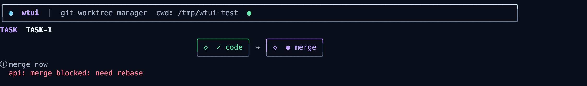
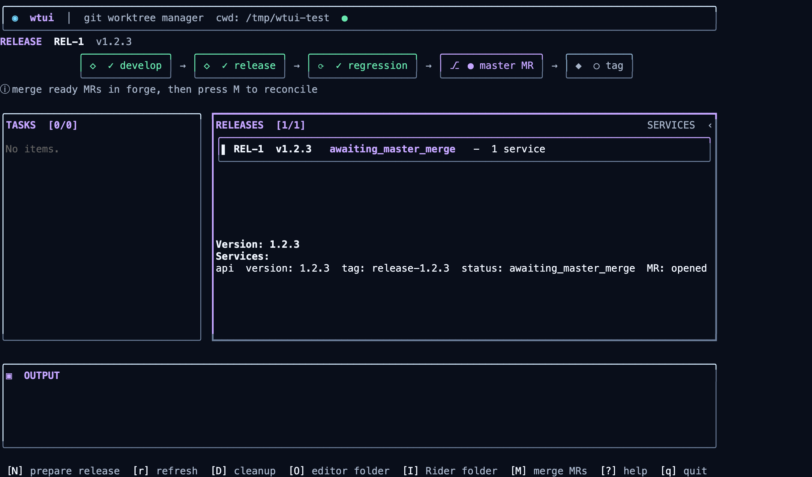

# wtui

**One task, many repositories, one terminal.**

`wtui` is a terminal UI for managing task-scoped Git worktrees across multi-repository and microservice codebases.


## Why wtui

A feature rarely stays inside one repository. You create the same branch several times, arrange worktrees by hand, repeat sync and push commands, then remember which services are ready to merge.

`wtui` treats that work as one task. Pick the repositories once, then manage their worktrees, branches, validation, reviews, and releases from one screen.

## Key terms

- **Task**: a named unit of work (for example `PROJ-101`) that groups the same branch across several repositories.
- **Worktree**: an extra working copy of a repository. Each service in a task gets its own worktree, so you never switch branches in your main clone.
- **MR/PR**: a merge request (GitLab) or pull request (GitHub). wtui creates them; the actual merge happens on GitHub/GitLab.
- **Release**: a separate wtui object that snapshots integrated work, promotes it to production, and tags versions per service.
- **Cleanup**: manual removal of finished task/release worktrees and directories. Always explicit, never automatic.

## Highlights

- **Task-scoped worktrees** - create matching branches and worktrees across selected repositories.
- **Multi-service operations** - sync, push, validate, and inspect an entire task together.
- **Your workflow, as configuration** - start from `git-flow`, `github-flow` or `trunk-based`, or describe your own branch types and state machines for tasks and releases in YAML: stands and QA before merge, QA loops, environment chains, CI gates, your own hook commands, service order, per-service close targets, GitHub merge queues and GitLab merge trains, versions from Conventional Commits. `wtui flow` shows what wtui will do; `W` in the TUI, `wtui flow --mermaid` and `wtui flow --html` (a self-contained page that works offline) draw it as a diagram.
- **GitHub and GitLab workflows** - create and inspect MRs/PRs through `gh` or `glab`. Merging stays on the forge; wtui reconciles the result. Tasks can link a Jira, GitHub or GitLab issue (added to the MR description) or start from a GitHub/GitLab issue, releases can publish GitHub/GitLab Release objects with the changelog, and `forge.remote` works with a fork plus an upstream remote.
- **AI where it saves time** - MR and release texts, `E` explains a failure and the next step, `wtui flow --draft "how your team works"` writes a validated `workflow:` block. It uses the Codex CLI with your ChatGPT login by default, or the Claude Code CLI with a Claude subscription if you set `ai.provider: claude`. AI is optional; everything else works without it.
- **Release orchestration** - prepare per-service versions, promote to production, and tag from one release view.
- **Focused workspaces** - generate a VS Code workspace for each task, plus a .NET solution when the `dotnet` CLI is installed.
- **Team defaults for MRs** - draft, labels, reviewers and assignees per task type or release (`mr:` in the [configuration reference](docs/configuration.md#mr-policy)).

## Install

Download a binary from [GitHub Releases](https://github.com/D1ssolve/wtui/releases), or install from source:

```bash
go install github.com/D1ssolve/wtui/cmd/wtui@latest
```

## Quick Start

1. Clone your service repositories into one existing directory. wtui doesn't clone anything; it finds Git clones up to a few levels below that directory (`root_dir`):

```text
~/dev/
├── gateway/   (git clone)
└── billing/   (git clone)
```

Pick the workflow your branches support. `git-flow` needs both `master` and `develop` in every repository, because features start from `develop`. If your repositories have only `main`, use `github-flow` (or `trunk-based`).

2. Create a config. `wtui init` asks for that directory, the task directory, the editor and a workflow, then writes a validated config:

```bash
wtui init
```

It writes `$XDG_CONFIG_HOME/wtui/config.yaml` (or `~/.config/wtui/config.yaml`), or the file named by `--config PATH`. An existing config is never overwritten: init stops unless you pass `--force`, and then it saves a backup next to it first. For a non-interactive setup with `main`-only repositories:

```bash
wtui init --root ~/dev --preset github-flow --yes
```

You can also write the file by hand. The minimal config is:

```yaml
root_dir: /Users/you/dev
tasks_root: /Users/you/dev/.tasks
editor: code

workflow:
  extends: github-flow   # git-flow needs master and develop
```

`root_dir` is where your service repositories live. `tasks_root` is where task worktrees go. Nothing else is required to start; every other key has a default (see the [configuration reference](docs/configuration.md)).

3. Check the workflow, then start wtui:

```bash
wtui flow
wtui
```

Add `--config PATH` to either command to use another file. `wtui --help` lists every command.

4. Press `i`, enter a task ID (for example `PROJ-101`), and select the repositories involved. wtui creates a branch and a worktree per service:

```text
.tasks/PROJ-101/
├── gateway/
├── billing/
├── PROJ-101.code-workspace
└── PROJ-101.sln   (only with the dotnet CLI)
```

5. Press `O` to open the task in your editor, write code, and commit as usual.

Press `?` at any time for keyboard help for the focused panel, or `:` / `Ctrl+P` to search and run any available action.

While a long operation runs, `Esc` can cancel it only if wtui marks it safe to interrupt; `y` confirms. Other operations just tell you to wait. Cancelling never quits wtui and never rolls back: anything already done stays done, and wtui reports the outcome so you can check it and repeat the action.

## Everyday flow

The default path from task to a cleaned-up release (with the `git-flow` preset):

1. **Develop** - work in the task worktrees. `V` validates Git state (clean worktree, no interrupted merge/rebase); it does not run your application tests. `S` syncs branches.
2. **`C` (Close)** - shows a plan, then pushes source branches. What `C` does is defined by the task type's `close` steps in `workflow`: it creates MRs for a `review` step, merges directly for a `merge` step, and once the reviews are verified as merged runs the remaining steps (`tag`, `cherry_pick`, `pipeline`).
3. **Review and CI** - complete reviews and wait for CI on GitHub/GitLab.
4. **`M` (Merge)** - rechecks readiness, asks for confirmation, merges ready MRs, and verifies the result.
5. **Release** - in the Releases panel (`3`), press `N` to bundle merged tasks into a release and `F` to move it to its next step. With `git-flow`, `F` opens production MRs, `M` merges the ready ones, and `F` again back-merges and tags; with `trunk-based`, `F` tags the release branch. The release steps come from `workflow.release`.
6. **`D` (Cleanup)** - remove the finished task and release worktrees manually. See below.



## Cleanup is always manual

Nothing is deleted automatically. Not after Close, not after an MR merge, not after tagging, not after release finalization. Finished tasks and releases stay on disk until you remove them.

One exception: temporary integration worktrees used internally during release preparation are managed by the release flow itself (see `release.keep_integration_worktrees` in the [configuration reference](docs/configuration.md)). This does not affect your task or release directories.

To clean up:

1. Press `D` (or its alias `P`) in the Tasks or Releases panel.
2. wtui runs a read-only scan and lists candidates. Nothing is touched yet.
3. Select the items you want to remove.
4. Each selected item is replanned and confirmed individually before anything is deleted.

When the full scan is too slow or you already know the target, press `d` in the Tasks panel to clean up only the selected task, or in the Releases panel to clean up only the selected released release. This skips the scan and goes straight to the per-item plan and confirmation; everything else works the same.

Cleanup removes worktrees, generated metadata, and task/release directories. It also deletes the local task and release branches it proves merged and unchanged; the plan lists them. Remote branches stay unless you tick remote deletion and confirm it in a second dialog. Cleanup never deletes tags; deleting a release with `x` in Releases is a separate action that also removes its branches and tags. Directories containing unknown files are preserved and reported; a separate force confirmation can remove them.

Steps run one at a time and nothing is rolled back. If a check fails midway, for example because a push URL changed, the remaining steps stop and finished ones stay done. Read the output, then press `D` again to plan what's left. Details: [cleanup guide (Russian)](docs/cleanup.md) and the [configuration reference](docs/configuration.md#release-cleanup).


## Release workflow at a glance



Prepare per-service versions, move each release through the steps your workflow defines, and tag from one release view. Full guides: [Russian](docs/workflows.md) and [English](docs/workflows.en.md).

## Optional Tools

- [`lazygit`](https://github.com/jesseduffield/lazygit) for service-level Git operations
- [`gh`](https://cli.github.com) for GitHub pull requests and workflows
- [`glab`](https://gitlab.com/gitlab-org/cli) for GitLab merge requests and pipelines

wtui detects available tools automatically. Press `.` to view current integration status.

## Requirements

- Git 2.5+
- On Windows, workflow `hook` commands run through `cmd.exe`, not `sh`, so write them for that shell. The Claude provider needs the native `claude.exe` on `PATH`.
- Go 1.26.1+ when installing from source
- A true-color terminal is recommended

## Documentation

- [Task-to-release workflows, step by step (Russian)](docs/workflows.md)
- [Task-to-release workflows, step by step (English)](docs/workflows.en.md)
- [Manual cleanup guide (Russian)](docs/cleanup.md)
- [Complete configuration reference](docs/configuration.md)
- [Releases](https://github.com/D1ssolve/wtui/releases)
- [License](LICENSE)

## Development

```bash
make test
make lint
make build
```
